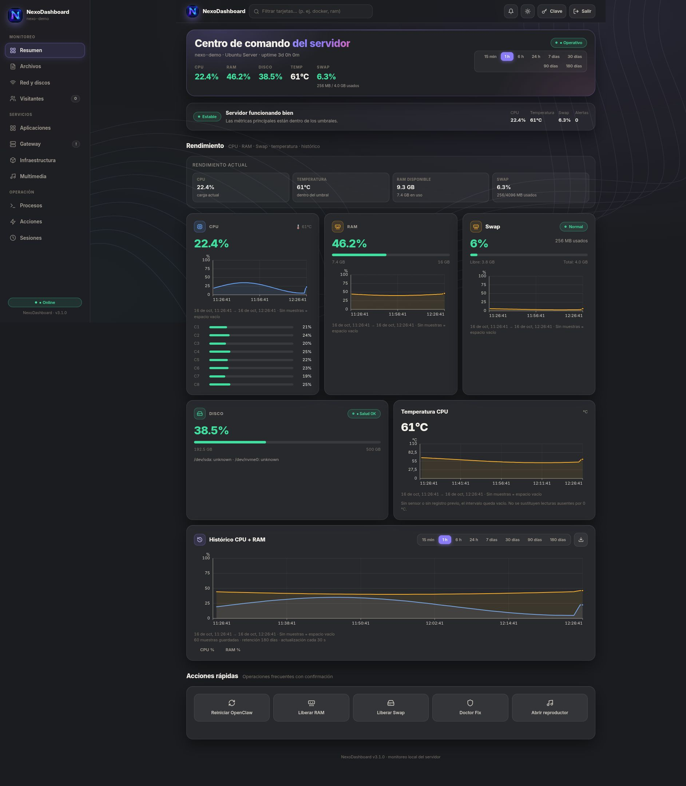
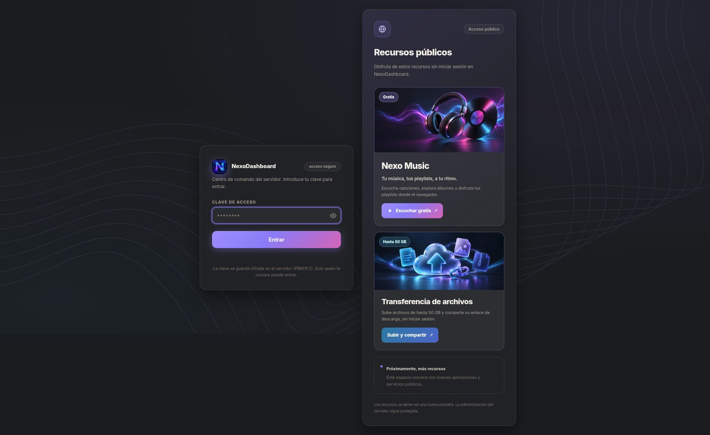
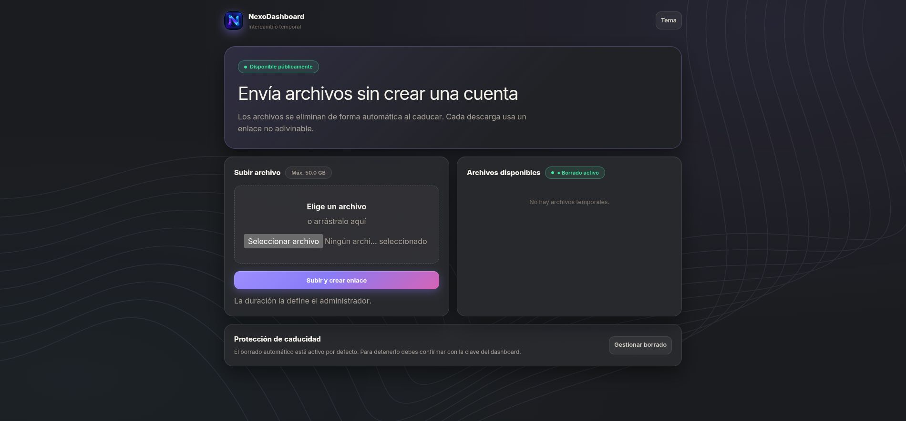

<p align="center">
  
</p>

# NexoDashboard · 3.2.0

Tu servidor, de un vistazo. Un panel web autohospedado para consultar rendimiento,
administrar servicios y compartir archivos desde una misma interfaz.

Construido con **Node.js, Express, Socket.IO y SQLite**, con interfaz en español,
tema claro/oscuro y vistas separadas para cada módulo. No requiere un servidor
de base de datos adicional.

[Instalación](#instalación) · [Configuración](#configuración) · [Capturas](#capturas) ·
[Despliegue](#despliegue) · [Solución de problemas](#solución-de-problemas)



> Las capturas se tomaron en una instancia aislada con datos de demostración.
> No contienen archivos, credenciales ni métricas del servidor de producción.

## Qué puedes hacer

| Módulo | Funcionalidades |
| --- | --- |
| Resumen | CPU total y por núcleo, RAM, Swap, almacenamiento, temperatura y estado operativo. |
| Gráficas e historial | Ejes con hora, minuto y segundo; rangos de 15 min a 180 días, datos persistentes y exportación CSV de CPU/RAM. |
| Archivos | Transferencia pública, progreso de subida, enlaces compartibles, caducidad y administración privada. |
| Aplicaciones | Lanzador con logos, búsqueda, categorías, estado del servicio y controles privados de inicio/parada. |
| Red y discos | Tráfico de red, actividad de disco y diagnóstico SMART cuando está disponible. |
| Visitantes | Sesiones de navegación diferenciadas por dispositivo/navegador y URL actual de los sitios instrumentados. |
| Infraestructura y procesos | Contenedores, servicios, procesos, registros y comprobaciones del servidor según las herramientas disponibles. |
| Multimedia | Control del reproductor interno compatible con MPD y datos de audio/Bluetooth según el equipo. |
| Operación | Acciones administrativas con confirmación en modal, auditoría y gestión de sesiones. |
| Gateway | Integración opcional con OpenClaw y acceso a su panel. |

Las integraciones dependen de los servicios instalados y sus permisos: el
dashboard no instala MPD, Docker, OpenClaw ni las aplicaciones del catálogo.

### Novedades de 3.2.0

- Indicador en cada aplicación: activo, detenido, parcial, sin verificar o
  respuesta HTTP cuando no se ha asociado un proceso.
- Iniciar/detener servicios asociados de Docker o systemd con confirmación en
  modal, auditoría, límites de operaciones y actualización automática cada 15 s.
- Protección del dashboard, archivos públicos y proxies compartidos. Un estado
  sin verificar no habilita acciones. No se inician servicios automáticamente.
- Configuración opcional `APP_SERVICES_CONFIG` para adaptar las asociaciones
  al servidor, sin aceptar comandos ni nombres de unidades desde el navegador.

### Novedades de 3.1.2

- Restaurado el tooltip de las gráficas: muestra hora, valor y unidad de la
  muestra más cercana al cursor, con guía vertical y puntos resaltados.
- En gráficas con varias series muestra cada valor por separado. No inventa
  muestras en huecos sin datos. También admite toque y navegación con teclado:
  enfocar la gráfica con Tab, usar flechas/Home/End y Escape para cerrar.

### Novedades de 3.1.1

- Etiquetas de las gráficas sin fecha en intervalos de hasta 24 horas: solo
  hora, minuto y segundo. Los intervalos de varios días conservan las fechas.

### Novedades de 3.1.0

- Intervalo compartido entre resumen e histórico: **15 min, 1 h, 6 h, 24 h,
  7, 30, 90 y 180 días**.
- Las gráficas conservan la ventana seleccionada completa, incluso si solo
  existen unos minutos de muestras. Los huecos no se rellenan con datos falsos.
- Gráfica de temperatura y persistencia de temperatura/Swap en SQLite.
- Mayor visibilidad de Swap junto a CPU y RAM; Disco pasa a la fila inferior.
- Estado crítico confirmado por tiempo sostenido, en lugar de un pico aislado.

## Capturas

### Acceso y recursos públicos

La administración requiere iniciar sesión. Los accesos a música y transferencia
de archivos se ofrecen por separado, sin iniciar sesión en el dashboard.



### Transferencia de archivos

La página pública muestra la duración configurada por el administrador y el
catálogo disponible. Al subir un archivo ofrece su enlace y tiempo restante.



## Requisitos

- **Node.js >=22.13.0** con `node:sqlite` disponible; el despliegue existente se
  ha comprobado con Node 24.
- **npm** y **Git**.
- **Linux** para la cobertura completa de métricas y operaciones del sistema.
- Espacio de disco suficiente para los archivos compartidos y la base de datos.

Comprueba el entorno antes de instalar:

```bash
node --version
npm --version
node -e "require('node:sqlite')"
```

Docker, systemd/journalctl, smartctl, MPD y las herramientas de audio son
opcionales. La falta de un sensor o herramienta puede dejar su módulo sin datos;
no significa necesariamente que todo el panel haya fallado.

## Instalación

### 1. Descargar e instalar dependencias

```bash
git clone https://github.com/An3ramirez/nexoDashboard.git
cd nexoDashboard
npm ci
```

### 2. Definir la clave inicial

En una instalación nueva, crea **`auth.json` en la raíz del proyecto** con tu
propia clave larga y única. Este ejemplo es una plantilla, no una clave por defecto:

```json
{
  "password": "REEMPLAZAR_POR_TU_CLAVE_PRIVADA"
}
```

```bash
chmod 600 auth.json
```

Al arrancar, el servidor convierte este formato inicial a `salt` + hash PBKDF2.
No publiques ese archivo, no reutilices la clave del ejemplo y no sobrescribas
un `auth.json` existente al actualizar. Sin una configuración válida, el servicio
se niega a arrancar. Después puedes cambiar la clave desde la barra del panel.

### 3. Iniciar

```bash
PORT=3100 node index.js
```

Abre **http://127.0.0.1:3100** e introduce la clave elegida. Detén el proceso
con `Ctrl+C`. El servidor escucha únicamente en `127.0.0.1`; para acceso remoto
utiliza un proxy inverso configurado expresamente.

## Configuración

Las opciones se leen del entorno del proceso. **El proyecto no carga `.env`
automáticamente**: expórtalas en tu shell o decláralas en el servicio systemd.

| Variable | Valor por defecto | Para qué sirve |
| --- | --- | --- |
| `PORT` | `3000` | Puerto HTTP local. |
| `PUBLIC_FILES_DIR` | `data/public-files` dentro del proyecto | Carpeta de binarios y ubicación predeterminada de SQLite. Usar una ruta absoluta fuera del checkout en producción. |
| `DASHBOARD_DB_PATH` | `$PUBLIC_FILES_DIR/nexodashboard.sqlite` | Ruta alternativa del archivo SQLite. |
| `HISTORY_RETENTION_DAYS` | `180` | Retención de métricas, entre 1 y 3650 días. No cambia la caducidad de los archivos. |
| `APP_SERVICES_CONFIG` | Perfil incluido en `application-services.js` | Ruta absoluta a un JSON de asociaciones de servicios. Reemplaza el perfil completo; `{}` desactiva controles externos. Ver [guía](docs/applications.md). |

Ejemplo con datos fuera del repositorio:

```bash
mkdir -p /srv/nexodashboard-data/files
export PORT=3000
export PUBLIC_FILES_DIR=/srv/nexodashboard-data/files
export DASHBOARD_DB_PATH=/srv/nexodashboard-data/nexodashboard.sqlite
export HISTORY_RETENTION_DAYS=180
node index.js
```

Prepara esas carpetas con el administrador del sistema y asigna permisos al
usuario que ejecuta Node; no ejecutes el dashboard como root solo para poder
escribir en `/srv`.

### Adaptar las integraciones a tu servidor

- **Aplicaciones:** revisa el catálogo inicial de `applications.js` y sustituye
  sus dominios por los tuyos **antes del primer acceso**. Después queda guardado
  en SQLite y cambiar la lista inicial no sobrescribe el catálogo existente.
  No hay todavía editor del catálogo ni descubrimiento automático. Consulta
  [la documentación del catálogo](docs/applications.md).
- **Recursos públicos del login:** sus enlaces se definen en `public/login.html`.
  El servicio de música es externo al dashboard y debe desplegarse por separado.
- **Multimedia y OpenClaw:** revisa rutas, comandos, puertos y usuario de sesión
  en `index.js` y `extras.js`; algunas integraciones están adaptadas al entorno
  original y no tienen variables de entorno dedicadas.
- **Acciones del sistema:** requieren herramientas y permisos específicos.
  Concede solo los permisos necesarios; no habilites `sudo` sin restricciones.

## Archivos públicos y almacenamiento

- `/files` permite subir y descargar **sin login**. El catálogo de archivos
  también es público: no lo uses como almacenamiento confidencial.
- Límite de **50 GB por archivo** en la interfaz, equivalente a 50 GiB binarios
  en el servidor. El navegador sube fragmentos de 32 MiB para evitar una única
  petición gigante.
- Los datos se escriben en streaming al disco; SQLite guarda metadatos,
  configuración y hashes de claves, **no los binarios**.
- El visitante no elige duración ni claves. Desde el módulo privado **Archivos**,
  el administrador controla caducidad, limpieza y persistencia.
- La limpieza intenta eliminar el binario antes de retirar su registro. Si
  falla, conserva el registro para reintentar en el siguiente ciclo.
- Los archivos persistentes no caducan automáticamente. Protege y respalda tanto
  la carpeta de binarios como la base de datos.

## Historial y estado operativo

SQLite conserva una muestra por minuto durante **180 días** por defecto.
Mientras está abierto el panel, las muestras en vivo complementan el histórico.
Las consultas agregan los rangos largos a unos 400 puntos para evitar cargar
seis meses completos en el navegador.

El rojo requiere estas condiciones continuas, evaluadas por separado:

| Métrica | Umbral crítico | Confirmación |
| --- | --- | --- |
| CPU | 100% | 10 minutos |
| RAM | Mayor de 80% | 10 segundos |
| Temperatura | 85 °C o más | 60 segundos |
| Disco | 95% o más | 60 segundos |
| Swap | 90% o más | 60 segundos |

La recuperación exige 30 segundos bajo su umbral de recuperación. Un hueco de
telemetría superior a 15 segundos reinicia una confirmación pendiente. Las
confirmaciones viven en memoria del servidor, no sobreviven a su reinicio y no
avanzan sin muestras. Los números actuales pueden cambiar de color antes que
el aviso global confirmado.

**Telegram todavía no está implementado.** Los avisos descritos son visuales.
Temperatura y Swap no se reconstruyen para muestras antiguas que no las tenían;
un dato ausente no se presenta como cero.

Para migraciones, copias consistentes y recuperación, consulta
[Almacenamiento e historial](docs/storage.md).

## Despliegue

El servidor Node queda detrás de un proxy inverso con HTTPS y soporte de
WebSocket. El proxy debe permitir las peticiones de subida fragmentadas y
tener tiempos de espera y espacio temporal acordes con las cargas grandes.
Un `413` puede proceder de Nginx u otro intermediario, aunque Node acepte 50 GB.

El repositorio incluye:

- [Servicio systemd](deploy/nexodashboard.service): adapta `User`,
  `WorkingDirectory`, `ExecStart` y `PUBLIC_FILES_DIR` a tu instalación.
- [Workflow de GitHub Actions](.github/workflows/deploy.yml): despliega un push
  o merge a `main`, y permite ejecución manual. Ejecuta pruebas, sincroniza el
  código, reinicia el servicio y consulta `/health`.
- [Guía del runner autoalojado](docs/deploy-runner.md): el runner debe funcionar
  como servicio para no depender de una terminal abierta.

**El workflow y el unit incluidos contienen rutas del despliegue original**:
no son una instalación universal. Ajusta las rutas de ambos y los permisos
antes de habilitarlos. Conserva `auth.json`, `data/` y los archivos subidos al
actualizar. En un repositorio público, protege `main` y no ejecutes código de
Pull Requests no confiables en el runner de producción.

Comprobación local del proceso, usando el puerto configurado:

```bash
curl --fail http://127.0.0.1:3000/health
```

`/health` comprueba el proceso del dashboard; no certifica que todas las
integraciones ni el proxy externo estén funcionando.

## Desarrollo y pruebas

### Política de versiones

Cada commit propio debe incrementar la versión siguiendo `MAJOR.MINOR.PATCH`:

- **PATCH**: correcciones, ajustes visuales, documentación o mantenimiento sin
  una funcionalidad nueva (`3.1.0` → `3.1.1`).
- **MINOR**: funcionalidades nuevas compatibles (`3.1.1` → `3.2.0`).
- **MAJOR**: cambios incompatibles (`3.2.0` → `4.0.0`).

Actualiza juntos `package.json`, las versiones raíz de `package-lock.json`, los
indicadores de la interfaz y el encabezado del README. MINOR reinicia PATCH a
cero; MAJOR reinicia MINOR y PATCH. No modifiques versiones de dependencias ni
versiones históricas de documentación/capturas solo para cambiar la versión de
la aplicación. No reescribas commits publicados para corregir un olvido.

### Ejecutar las pruebas

```bash
npm test
```

Las pruebas utilizan bases y archivos temporales, no credenciales de producción.
Cubren gráficos y rangos, confirmación de alertas, migración SQLite, retención,
subida, descarga, persistencia y reinicio. La prueba HTTP necesita escuchar en
localhost.

El frontend se sirve directamente desde `public/`; no requiere un bundler.
Si cambias utilidades Tailwind, regenera el CSS local y conserva el resultado:

```bash
npx tailwindcss -i src/tailwind.css -o public/tailwind.css --minify
```

Las utilidades se configuran en `tailwind.config.js`.

## Solución de problemas

| Síntoma | Qué revisar |
| --- | --- |
| El servidor no arranca | Versión de Node, disponibilidad de `node:sqlite`, `auth.json` y permisos sobre los directorios de datos. |
| Clave incorrecta | Clave de la instalación que estás abriendo; no existe una contraseña universal. No reemplaces el archivo de autenticación sin un respaldo. |
| La gráfica muestra pocos datos | El rango puede ser mayor que las muestras almacenadas. El espacio vacío es intencional; el historial no se recupera retroactivamente. |
| Temperatura o SMART sin datos | Sensor, herramienta o permisos no disponibles. No se simulan lecturas. |
| Carga rechazada con HTTP 413 | Límites del proxy/CDN y tamaño permitido por petición; comprueba también el espacio libre. |
| Un archivo no aparece tras actualizar | Misma ruta de `PUBLIC_FILES_DIR`/SQLite, caducidad y registros del servicio. No borres la base para intentar resolverlo. |
| Catálogo de apps no cambia al editar el código | La configuración ya está persistida en SQLite; la lista inicial solo se usa al crearlo. |

## Seguridad y límites actuales

- No subas `auth.json`, bases de datos, archivos recibidos, registros ni copias
  de producción al repositorio. Revisa el diff antes de publicar.
- La interfaz administrativa está autenticada; `/files`, su catálogo y sus
  descargas son públicos deliberadamente.
- Un enlace aleatorio **no sustituye** control de acceso ni cifrado de archivos.
  No se promete análisis antivirus ni cifrado de extremo a extremo.
- Protege la transferencia pública contra abuso con límites y controles del
  proxy adecuados a tu entorno.
- SQLite usa WAL y transacciones; no compartas un catálogo entre dos procesos
  escritores del dashboard porque también existe una caché en memoria.
- Las sesiones no constituyen un sistema multiusuario de cuentas y roles.
- El estado del proceso no garantiza que la aplicación funcione. Las sondas
  HTTP solo comprueban respuesta local, sin autenticar ni seguir redirecciones.
- Los controles de aplicaciones requieren permisos explícitos del usuario del
  servicio sobre sus unidades/contenedores. No se instalan permisos sudo ni se
  añaden usuarios al grupo Docker automáticamente.

Para reportar problemas, incluye versión, entorno, pasos para reproducir y errores
anonimizados. No publiques contraseñas, cookies, tokens ni enlaces a archivos privados.
